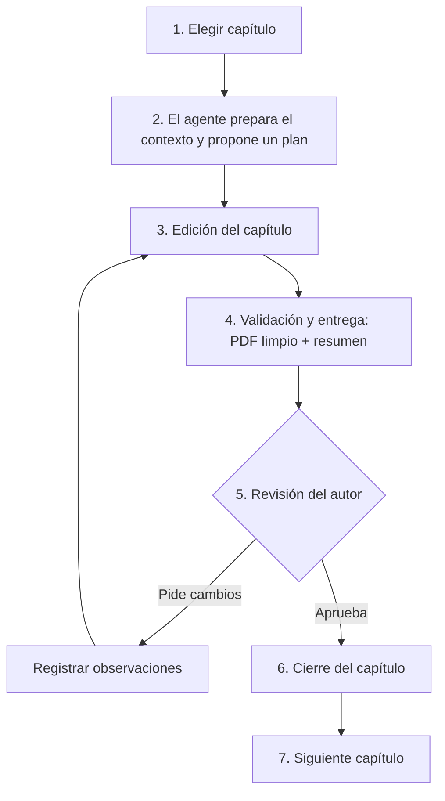

# Instrucciones de Trabajo con el Agente de IA — Segunda Edición

Guía práctica para editar ***Crítica de la Razón Mediática*** (Juan Barreto Cipriani) conversando en lenguaje natural con un agente de IA. No necesitas escribir comandos: el agente ejecuta por su cuenta las herramientas internas del proyecto.

> Las reglas técnicas completas del agente están en [`AGENTS.md`](AGENTS.md) y en la carpeta [`SSOT/`](SSOT/). Este documento es la guía de uso para la persona que dirige la edición.

---

## 1. Cómo funciona el proyecto

| Carpeta / archivo | Qué es | ¿Se edita? |
| :--- | :--- | :--- |
| [`libro/`](libro/) | **Única copia viva** del texto publicable en Markdown (un archivo por capítulo). | Sí, un capítulo a la vez. |
| [`libro.yaml`](libro.yaml) | Orden del índice y estado de cada capítulo: `pendiente`, `en_revision` o `aprobado`. | Lo actualiza el agente; `aprobado` solo con tu confirmación. |
| [`notas/`](notas/) | Pendientes, mapa de la obra, registro de cambios, fichas por capítulo y fichas de bibliografía. | Sí. |
| [`externos/`](externos/) | Biblioteca de libros y artículos de apoyo. | **Solo lectura**: tú depositas archivos, el agente los consulta. |
| [`SSOT/`](SSOT/) | Reglas de estilo, voz del autor, flujo editorial y maquetación. | Solo ante cambios de reglas. |
| [`respaldo_v1.0/`](respaldo_v1.0/) y [`fuente/`](fuente/) | La Primera Edición (2006) congelada, con su PDF y maquetación originales. | **Intocables**. |
| `dist/` | PDFs y reportes generados para revisión. No se sube a Git. | Lo genera el agente. |

**Principios básicos:**
- Se trabaja **un capítulo a la vez**.
- El texto de 2006 se conserva: se integra material nuevo con el mismo tono, sin borrar la argumentación original.
- El agente nunca inventa citas ni páginas. Si no puede verificar algo, lo marca como `[VERIFICAR CITA/PÁG.]`.
- Los textos de autores invitados no se reescriben: los cuatro prólogos *Pro(Logos) I–IV* y el ensayo de Javier Biardeau en el *Post Scriptum* (desde la línea 101).
- El agente no hace `commit` ni `push`, ni marca un capítulo como aprobado, sin tu orden expresa.

---

## 2. Ciclo de edición de un capítulo

### Paso 1 — Elegir el capítulo
Indica el capítulo por su número o por su tema. Ejemplos de lo que puedes pedir:

- *«Vamos a trabajar el capítulo 19.»*
- *«Muéstrame el avance de los capítulos.»*
- *«Sigamos»* o *«¿cómo vamos?»* (el agente retoma el estado de la sesión anterior).

### Paso 2 — Contexto y plan previo
El agente revisa el capítulo, su ficha en `notas/`, el mapa de la obra, la voz del autor y las fuentes asignadas. En capítulos extensos (más de 3.000 palabras) te propondrá primero un **plan breve de 5 a 8 viñetas**: qué apartados intervendrá, qué 2 o 3 fuentes entrarán en diálogo profundo y qué erratas de 2006 revisará. Puedes aprobarlo, recortarlo o redirigirlo.

Si ya sabes qué quieres, dalo directamente:

- *«Actualiza el capítulo 19 integrando el giro de la inteligencia artificial generativa, con 2 o 3 fuentes en diálogo.»*
- *«En el capítulo 12 actualiza solo las cifras de 2006 y tiende puente al presente.»*

### Paso 3 — Edición
El agente aplica las **7 decisiones editoriales** del proyecto:

1. **Integración híbrida:** aportes nuevos tejidos dentro del texto, sin borrar el argumento de 2006; subapartados nuevos solo ante giros históricos mayores.
2. **Anclaje temporal:** cifras y ejemplos de 2006 se contextualizan («hace dos décadas…») y se enlazan con el presente verificado.
3. **Fuentes en otro idioma:** cita traducida al español en el cuerpo y nota con la edición original y `[trad. propia]`.
4. **Autores invitados:** se conservan íntegros como memoria de 2006.
5. **Entrega por defecto:** PDF limpio y un resumen de 5 a 10 viñetas.
6. **Uniformidad al paso:** comillas `«»` para citas, `""` para énfasis, `Ibíd.` y `Op. cit.` normalizados, y errores recurrentes corregidos.
7. **Anexo editorial de cierre:** el agente mantiene al día el anexo con la relación de cambios respecto a 2006.

Para citas externas, pídelo así:

- *«Busca qué dice Éric Sadin sobre el cuerpo-pantalla y verifica la página exacta.»*

El agente comprueba el folio impreso en el texto de la fuente, no solo el número de página del PDF.

### Paso 4 — Validación y entrega
Pide la entrega cuando el borrador esté listo:

- *«Valida el capítulo 19, genera su PDF limpio para el autor y dame un resumen breve de los cambios.»*

El agente revisa el capítulo, genera el PDF en `dist/` y te da el resumen. Si el autor prefiere Word o un PDF con párrafos numerados para comentar, pídelo expresamente:

- *«Genera también la versión Word.»*
- *«Genera el PDF con los párrafos etiquetados.»*

### Paso 5 — Revisión del autor
Pasa el PDF al autor y trae sus observaciones al agente:

- *«El autor pide estos cambios en el capítulo 19: …»*

El agente las registra en la ficha del capítulo, aplica los ajustes, vuelve a validar y regenera el PDF. Esto se repite hasta que el autor apruebe.

Si el autor descarta un borrador completo:

- *«El autor descartó este borrador del capítulo 19; revierte el archivo al último estado confirmado y anota qué enfoque evitar.»*

### Paso 6 — Cierre (solo tras aprobación explícita)
Solo cuando el autor lo haya aprobado:

- *«El autor aprobó el capítulo 19; ciérralo.»*

El agente marca como resueltas las notas aplicadas, actualiza el mapa de la obra, el registro de cambios y el anexo editorial, anota términos nuevos para el Glosario y la Bibliografía, cambia el estado a `aprobado` y lo registra en `CHANGELOG.md`. Después **tú** haces el `commit` y el `push` (por ejemplo, «cap 19 aprobado»), o se lo pides expresamente al agente.

### Paso 7 — Siguiente capítulo
Abre una conversación nueva (véase el apartado 4) y repite el ciclo.

---

## 3. Otras tareas frecuentes

| Quieres… | Dile al agente |
| :--- | :--- |
| Añadir bibliografía nueva | Deposita los archivos en `externos/` y di: *«Añadí nuevos archivos en `externos/`, procésalos e indexa todo.»* |
| Ver qué dice una fuente | *«Busca en las fuentes qué dice Harari sobre la vigilancia y verifica las páginas exactas.»* |
| Buscar algo en el propio libro | *«¿En qué capítulos aparece el concepto de biopolítica?»* / *«Busca la definición del término "habitus" en el Glosario.»* |
| Comparar con 2006 | *«Muéstrame los cambios del capítulo 19 respecto a la Primera Edición.»* |
| Ver la maqueta tipográfica | *«Genera la maqueta de prueba del capítulo 08.»* |
| Revisar la salud del proyecto | *«Valida todo el proyecto y dime si hay errores.»* |
| Hacer un análisis sin tocar nada | *«Analiza esto y dame recomendaciones, pero no modifiques ningún archivo.»* |

> **Análisis y recomendaciones:** cuando pidas un análisis, una opinión o una explicación, el agente no modifica archivos hasta que lo confirmes. Los cambios que afecten al orden o estructura del libro también se confirman antes de aplicarse.

---

## 4. Buenas prácticas para ahorrar contexto y cuota

1. **Una conversación nueva por capítulo.** Al entregar o cerrar un capítulo, abre una sesión nueva. En ensayos muy extensos (07, 10, 19, 26 y 27), conviene cambiar de conversación cada 2 o 3 bloques de trabajo.
2. **Retoma con «Sigamos».** El agente lee un estado de sesión local, el avance de `libro.yaml` y el último registro de cambios, así que no pierdes el hilo al cambiar de conversación.
3. **Pide un guardado antes de cerrar la conversación:** *«Guarda el estado de la sesión: capítulo, tramo en curso, último paso, próximo paso y pendientes.»* El archivo es local (no se sube a Git) y se sobrescribe, sin acumular historial.
4. **Agrupa peticiones.** En rondas de correcciones o ajustes de maquetación, reúne 4 a 6 cambios en un solo mensaje.
5. **No pidas releer el capítulo completo** tras editar: pide que el agente muestre las diferencias.
6. **Reserva el modelo más potente** para planear y redactar prosa filosófica; usa uno ligero para tareas mecánicas (validar, compilar, buscar citas, fichar libros).

---

## 5. Fase final: cierre editorial

Cuando los capítulos principales estén aprobados, pide el cierre global **una sola vez**:

- *«Vamos a hacer el cierre editorial.»*

Incluye la consolidación de la Bibliografía y el Glosario, la renumeración de notas al pie, la regeneración del Índice General, el Anexo editorial de cambios y el Índice Onomástico con la compilación completa del manuscrito. Hasta ese momento el Índice General y el Onomástico no se tocan.

---

## 6. Qué no debe hacer nunca el agente

- Modificar `respaldo_v1.0/`, `fuente/`, `externos/` o el pipeline histórico de extracción.
- Reescribir los textos de autores invitados sin orden expresa.
- Inventar citas, páginas o datos.
- Borrar notas al pie existentes o renumerarlas a mano.
- Marcar un capítulo como `aprobado`, o ejecutar `commit` o `push`, sin tu confirmación.
- Crear ramas o etiquetas: se trabaja siempre en `main`.

Si notas que el agente contradice alguna de estas reglas, o que dos documentos del proyecto se contradicen entre sí, pídele que se detenga y lo reporte; para corregirlo, que active el procedimiento de mantenimiento del proyecto.
